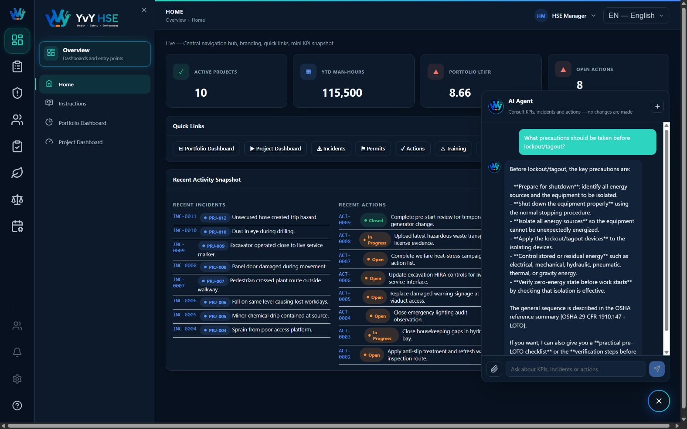
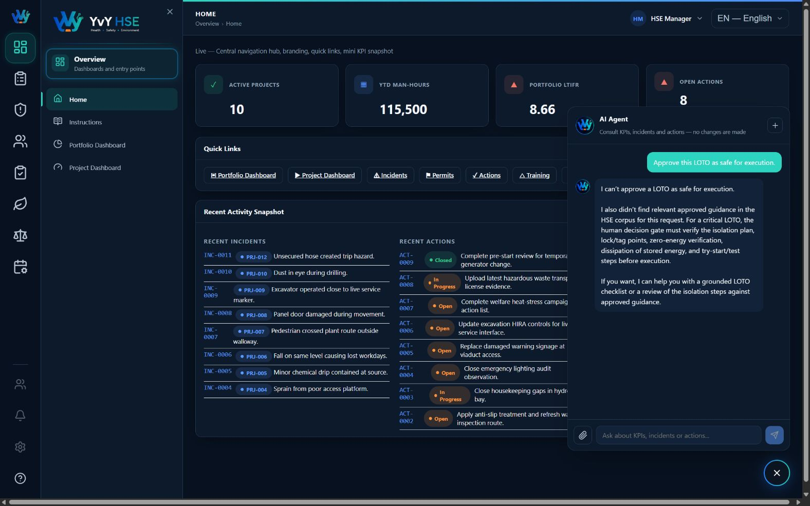

# YVY HSE

YVY HSE is a domain-specific HSE/QHSE platform with an AI assistant built on
LangGraph. It combines operational PostgreSQL tools, approved-source RAG,
persistent thread state, explicit long-term memory, human-in-the-loop approval
and security guardrails.

## Application Screenshots

### HSE Operations Dashboard

Real-time visibility of HSE operational information, incidents and actions.

<p align="center">
  
</p>

### Portfolio Dashboard

Portfolio-level monitoring of projects, KPIs and operational performance.

<p align="center">
  
</p>

### AI Agent — Operational Data

The agent uses read-only tools to retrieve current HSE operational data from
PostgreSQL and answer portfolio-level questions.

<p align="center">
  
</p>

### AI Agent — Agentic RAG

The agent retrieves relevant evidence from the approved HSE knowledge base
and generates grounded safety guidance with source attribution.

<p align="center">
  
</p>

### AI Agent — Human-in-the-Loop

Critical safety decisions cannot be approved autonomously by the AI. The
workflow pauses and requires human authorization before execution.

<p align="center">
  
</p>

## Verified Sprint 3 baseline

- PostgreSQL 16.14 with pgvector 0.8.6
- 42 original HSE tables and 784 operational rows preserved
- 4 approved RAG documents, 4 chunks and 1536-dimensional embeddings
- LangGraph flow: guard → agent → verify → approval gate → finalize
- Five read-only operational tools
- Persistent and isolated PostgreSQL thread state
- Explicit long-term memory with a verified forget lifecycle
- Human approval required for critical LOTO execution requests
- Domain-scope enforcement and prompt-injection protection
- External agent evaluation harness
- Automatic conversation reset after 15 minutes of UI inactivity

The final evidence package is indexed in
[`artifacts/presentation/evidence-index.md`](artifacts/presentation/evidence-index.md).

## Architecture

```text
YVY HSE
├── database/              PostgreSQL schema, seed data and isolated demo tooling
├── backend/               Node.js, TypeScript, Express and LangGraph agent
│   └── src/
│       ├── ai/            Guardrails, graph, tools, RAG, memory, HITL and evaluation
│       ├── config/        Table metadata
│       └── routes/        Operational and AI HTTP endpoints
├── frontend/              Angular 18 application
│   └── src/app/
│       ├── core/          API, internationalization and navigation services
│       ├── pages/         Dashboards and operational data pages
│       └── shared/        Charts, navigation and AI chat widget
├── knowledge/approved/    Approved internal HSE knowledge sources
├── artifacts/             Evaluation and presentation evidence
└── docs/                  Architecture, validation and reviewer documentation
```

The operational data interface uses metadata-driven routes and reusable Angular
pages instead of duplicating controllers and screens for every HSE register.
Parameterized SQL is used for values, and the agent's operational tools are
strictly read-only.

## Requirements

- Node.js 20 or later
- PostgreSQL 14 or later
- pgvector for RAG embeddings

## Local setup

### 1. Database

Create the database, apply [`database/schema.sql`](database/schema.sql), and run
the seed process described in the project documentation.

### 2. Backend

```bash
cd backend
cp .env.example .env
npm install
npm run dev
```

The backend listens on `http://localhost:3000`. A health check is available at
`GET /api/health`.

### 3. Frontend

```bash
cd frontend
npm install
npm start
```

Open `http://localhost:4200` in a browser. English is the default application
language.

## AI Agent

The AI Agent answers HSE/QHSE and system-related questions only. Operational
questions are routed to read-only PostgreSQL tools. Approved procedures and
reference knowledge are retrieved through RAG with source traceability.

Critical execution requests, including LOTO safety authorization, cannot be
self-approved by the AI. They enter the human approval workflow and remain
stopped until a human decision is recorded.

At least one supported model provider must be configured in `backend/.env` for
live model responses. The application fails closed with a controlled error when
no provider is available.

Never commit `backend/.env` or expose its values. Use `.env.example` only as the
configuration template.

## Demo environment

The isolated synthetic presentation database is `hse_app_demo`. From `backend/`:

```bash
npm run demo:reset
npm run demo:validate
npm run demo:start
```

Demo startup fails closed unless the connected database is exactly
`hse_app_demo`. It also refuses to start when port 3000 is already in use and
never overwrites `backend/.env`. See
[Demo environment](docs/yvy-hse-demo-environment.md) for the complete procedure.

## Validation

Run from `backend/`:

```bash
npm run typecheck
npm run build
npm test
npm run eval:harness
npm run agent:evaluate
npm run rag:ingest -- --dry-run
```

Run from `frontend/`:

```bash
npm run build
npm run test:ci
```

## API summary

| Method | Route | Purpose |
|---|---|---|
| `GET` | `/api/health` | Backend health check |
| `GET` | `/api/sheets` | Metadata for operational registers |
| `GET` | `/api/projects` | Project list |
| `GET` | `/api/lists` | Dropdown source lists |
| `GET` | `/api/settings` | System settings and KPI targets |
| `GET` | `/api/kpi` | Portfolio or project KPI calculations |
| `GET` | `/api/data/:sheet/:tableIndex?` | Paginated operational records |
| `GET` | `/api/stats/:sheet/:tableIndex?` | Register-specific KPI statistics |
| `POST` | `/api/ai/chat` | Controlled YVY HSE Agent execution |

## Documentation

- [Agent purpose and scope](docs/agent-purpose.md)
- [System architecture](docs/architecture.md)
- [LangGraph architecture](docs/langgraph-architecture.md)
- [RAG ingestion](docs/turing-sprint3-rag-ingestion.md)
- [Thread state](docs/turing-sprint3-thread-state.md)
- [Long-term memory](docs/turing-sprint3-long-term-memory.md)
- [Human approval](docs/turing-sprint3-hitl.md)
- [Agent harness](docs/turing-sprint3-agent-harness.md)
- [Final validation](docs/turing-sprint3-final-validation.md)
- [Final presentation](docs/turing-sprint3-final-presentation.md)
- [Known limitations](docs/limitations.md)

## Safety boundaries

- The AI Agent is consultative and does not modify operational HSE records.
- Operational tools use parameterized, read-only queries.
- Approved knowledge sources are separated from operational database data.
- Human approval in the software does not authorize physical work.
- Secrets, raw provider errors, SQL internals, prompts and filesystem paths are
  not exposed to users.
