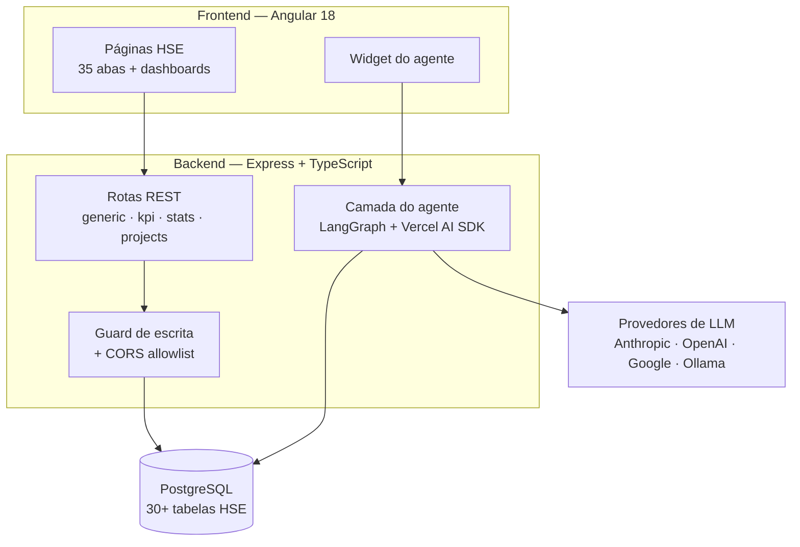

# Arquitectura do sistema

## Visão geral



## Camadas

| Camada | Tecnologia | Responsabilidade |
|---|---|---|
| Interface | Angular 18 standalone, SCSS, lucide | Páginas HSE, dashboards, chat |
| API | Express 4, TypeScript 5.9 | REST, SSE, rate limit, CORS, validação Zod |
| Orquestração | LangGraph 1.4 | Estados, nós, decisões — ver [langgraph-architecture.md](langgraph-architecture.md) |
| Modelo | Vercel AI SDK 7 | Provedores, streaming, tool calling |
| Dados | PostgreSQL 16 + pgvector, driver `pg` | Dados HSE e armazenamento vectorial; SQL parametrizado, sem ORM |

## Dados

30+ tabelas geradas por `database/schema.sql` a partir da planilha de referência, semeadas
por `database/seed.js`. O nome de cada tabela deriva do nome da aba pela mesma função `slug()`
usada no backend, o que mantém aba ↔ tabela ↔ rota consistentes.

As alterações incrementais passam por migrações SQL versionadas em `database/migrations`,
registadas em `schema_migrations`. As tabelas `rag_documents` e `rag_chunks` ficam separadas
das tabelas operacionais e não são expostas por nenhuma rota.

A ingestão RAG é uma operação administrativa explícita (`npm run rag:ingest`), com allowlist,
normalização e chunking determinísticos, embeddings isolados e substituição transaccional. O
allowlist de produção está vazio porque a auditoria não encontrou corpos documentais HSE
aprovados; dados operacionais continuam em SQL/tools. A pesquisa, as citações e a integração
LangGraph ainda não estão implementadas.

O CRUD genérico (`routes/generic.ts`) serve as 35 abas com um único endpoint parametrizado,
lendo `config/tableMeta.json` para saber colunas e tipos. O frontend espelha isso com um único
componente `pages/sheet`.

## O agente

Detalhe completo em [langgraph-architecture.md](langgraph-architecture.md). Em resumo:

```
POST /api/ai/chat
  → validação Zod
  → resolveModel (allowlist no servidor)  → 503 se não configurado
  → orquestrador (AI_ORCHESTRATOR)
      langgraph: guard → agent → verify → finalize
      legacy:    guard → streamText → verify inline
  → SSE: text | tool_use | error, depois done
```

Quatro ferramentas, todas de leitura: `get_kpi`, `list_incidents`, `list_actions`,
`get_projects`. Definidas uma só vez em `ai/tools.ts` e partilhadas pelos dois orquestradores.

## Segurança actual

| Guard | Onde |
|---|---|
| Rate limit 20/min no chat | `routes/aiChat.ts` |
| Limite de corpo 256 kb | `index.ts` |
| Validação Zod da requisição | `routes/aiChat.ts` |
| Guard de prompt injection | `ai/graph/nodes/guard.node.ts` |
| Allowlist de modelos no servidor | `ai/providers.ts` |
| Segredos nunca enviados ao cliente | `listProvidersForClient()` |
| SQL parametrizado | todas as rotas e tools |
| CORS por allowlist | `index.ts` |
| Escrita bloqueada sem autenticação | `index.ts` |
| Limite de passos do agente | `ai/config.ts` |
| Timeout do modelo | `ai/config.ts` |

O que **não** existe: autenticação, RBAC, multi-tenant, validação de output.
Ver [limitations.md](limitations.md).

## Configuração

O bootstrap `backend/src/config/env.bootstrap.ts` carrega `backend/.env` por um caminho
determinístico relativo ao backend, independentemente da directoria actual do terminal. O
servidor e o CLI de ingestão usam o mesmo bootstrap. Variáveis já injectadas no processo têm
precedência; `.env` serve apenas como fallback local e permanece ignorado pelo Git.

Variáveis em `backend/.env` — modelo em `backend/.env.example`:

| Variável | Efeito |
|---|---|
| `AI_ORCHESTRATOR` | `langgraph` (omissão) ou `legacy`; valor inválido falha no arranque |
| `CORS_ORIGINS` | Origens permitidas, separadas por vírgula |
| `ALLOW_UNAUTHENTICATED_WRITES` | `true` liberta POST/PUT/DELETE — apenas desenvolvimento |
| `DATABASE_URL` | Ligação ao Postgres |
| `ANTHROPIC_API_KEY` etc. | Ativam cada provedor; sem chave, o provedor não aparece |

## Sprint 2.2C — retrieval architecture

The four approved curated summaries are retrieved with parameterized pgvector cosine search.
`search_hse_knowledge` is a fifth read-only tool, reserved for reusable HSE procedures and
guidance. Current counts, statuses, dates, and operational records remain on SQL tools; the RAG
tool is withheld for those queries. Retrieval returns ranked traceable evidence but never
embedding vectors. The unchanged graph flow is `guard → agent → verify → finalize/refuse`;
verification requires a real returned citation label for evidence-backed answers. Retrieved
content is treated as untrusted data and jurisdiction is explicitly constrained. Full design and
validation: [turing-sprint3-rag-retrieval.md](turing-sprint3-rag-retrieval.md).

## Sprint 3.1 — persistent thread state

The LangGraph API path restores bounded short-term conversation state from PostgreSQL by a
validated UUID `threadId` (`conversationId` remains a compatible alias). The additive
`agent_thread_state` table contains only recent user/assistant messages and minimal RAG source
references. Successful runs are atomically upserted; failed/refused runs leave the previous
checkpoint unchanged. No vectors, chunks, tool result sets, prompts, or credentials are stored.
The graph topology remains unchanged. See
[turing-sprint3-state-management.md](turing-sprint3-state-management.md).

## Sprint 3.2 — controlled long-term memory

Explicit, allowlisted application-level memories are stored separately in
`agent_long_term_memory`. The `save_memory` tool exists only for messages with explicit remember
intent. Before a run, at most three lexically relevant active memories are injected below the
system policy as untrusted context. Normal transcripts, RAG chunks, vectors, secrets, personal
data, and operational records are excluded. Memories support content-hash idempotency, explicit
keyed updates, and internal disable/forget semantics. See
[turing-sprint3-long-term-memory.md](turing-sprint3-long-term-memory.md).

## Sprint 4.1 — controlled HITL

A deterministic `approval_gate` follows graph verification. Safety-critical LOTO execution
approval requests persist a minimal PENDING record in `agent_human_approval` and finish the
invocation as `AWAITING_HUMAN_APPROVAL`; they cannot reach normal finalization. A distinct
internal resume path atomically applies one APPROVE or REJECT decision only when approval and
thread UUIDs match. RAG and memory remain untrusted context and cannot authorize. No public
approval endpoint, UI, identity claim, or operational LOTO mutation was added. See
[turing-sprint3-hitl.md](turing-sprint3-hitl.md).

## Sprint 5 — Agent Harness and evaluation

The evaluation layer is separate from the product agent. A versioned case dataset is executed
through an injected adapter, normalized into a minimal observation, and checked against
deterministic expectations for routing, grounding, citations, safety, jurisdiction, state,
memory, HITL, refusal, secrets, and failures. Reports contain named checks and category totals,
not full prompts, responses, chunks, embeddings, or provider errors. The harness requires no
database migration and does not alter the LangGraph product flow. See
[turing-sprint3-agent-harness.md](turing-sprint3-agent-harness.md).
### Domain scope boundary

The Guard enforces the YVY HSE/QHSE domain before model execution. General-knowledge input follows `Guard -> Domain Scope -> OUT OF SCOPE -> Refuse`; it cannot call the general model, operational tools, RAG, memory retrieval or HITL. An unambiguously referential follow-up may reuse only earlier in-scope user context from the same persisted thread. Previous HSE context and long-term memory never authorize a new unrelated topic.

```text
User -> Guard -> Domain Scope
                  |-- OUT OF SCOPE -> Refuse
                  `-- IN SCOPE -> Agent -> Tools / RAG / HITL
```

# Agent evaluation layer

The isolated `backend/src/ai/evaluation` harness surrounds the public agent runner/interface with versioned scenarios, normalized observable outcomes and deterministic checks. It does not alter LangGraph routing or inspect chain-of-thought. Offline evaluation produces redacted JSON/Markdown artifacts under `artifacts/evaluation`; live provider validation remains a separately authorized activity.
