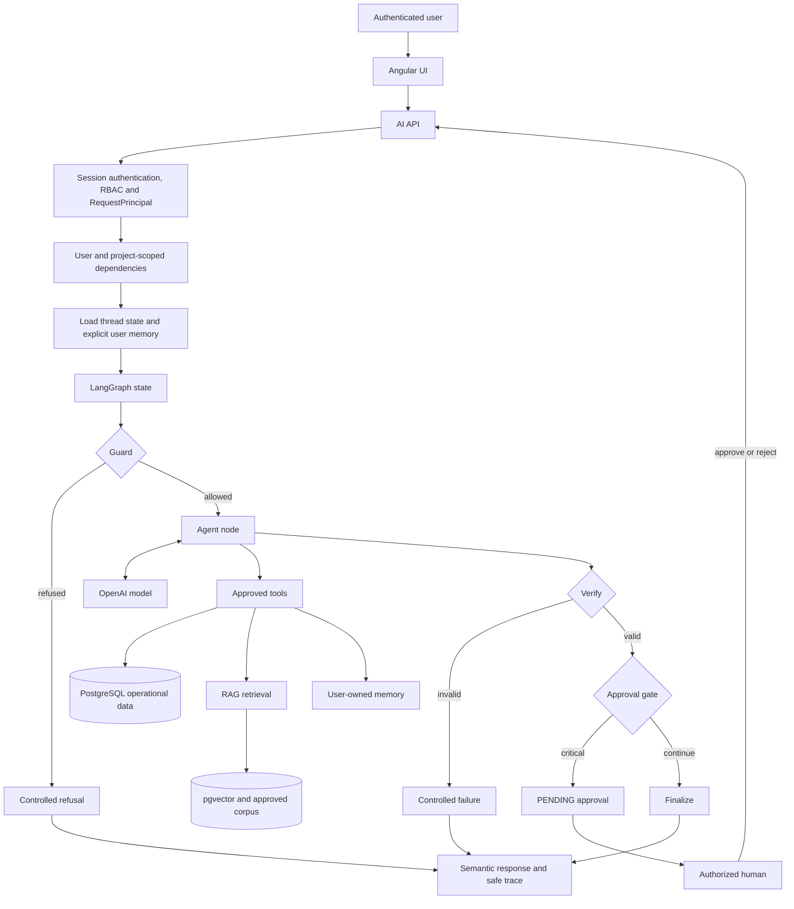

# YvY HSE Agent Architecture

## Agent Purpose

The YvY HSE Agent helps authenticated HSE professionals retrieve project-scoped operational data, consult approved safety knowledge, use limited user-owned context, and receive decision-support information through natural language. The model selects useful capabilities, but deterministic application controls retain authority over identity, data scope, tool execution, response state, and critical human approval.

The agent is not an autonomous safety authority, field inspector, replacement for competent-person verification, autonomous LOTO approver, unrestricted database agent, authorization bypass, or certified HSE decision system. It cannot verify physical field conditions and does not authorize work.

## Architecture Name

**Short name:** Controlled Stateful LangGraph Agent.

**Formal description:** YvY HSE uses a controlled stateful agent workflow implemented with LangGraph. A language model interprets requests, selects from approved tools, and composes answers inside one bounded agent node. Explicit deterministic nodes and server-side controls enforce input guardrails, verification, authorization, project scope, human-approval boundaries, failure semantics, and persistence ownership.

This is not a pure ReAct, Plan-and-Execute, or reflective-agent architecture. It contains a ReAct-like reason/action/observation loop inside the agent node, surrounded by a deterministic workflow.

## System Flow



The concrete graph topology is `START -> guard -> agent -> verify -> approval_gate -> finalize`, with alternate `refuse`, `finalize_failure`, and pending-to-`END` paths. Approval resolution is an application-controlled continuation through `resumeHumanApproval`; it is not native LangGraph checkpoint resume. `MemorySaver` exists only for volatile development/test use.

## Model-Driven vs Deterministic Components

| Component | Classification | Why |
|---|---|---|
| Natural-language interpretation | Model-driven | The provider interprets intent within the system prompt. |
| Tool selection and arguments | Model-driven within constraints | The model chooses an exposed tool and arguments, but only from the server-built registry. |
| Multi-step tool loop | Model-driven and bounded | The AI SDK returns observations to the model, capped by `MAX_AGENT_STEPS` and timeout. |
| Response generation | Model-driven | The model turns allowed evidence/tool results into the answer. |
| RAG query formulation | Model-driven | The model calls the approved search tool with a query. |
| Authentication and principal creation | Deterministic | Server middleware derives trusted identity from an HttpOnly session. |
| RBAC and project access | Deterministic | Permission and project checks execute in application code. |
| Tool availability and SQL scope | Deterministic | The composition root creates principal-scoped tools and repositories. |
| Input guard | Deterministic | Pattern, length, scope, attachment, and safety checks route before the model. |
| Structured-data versus RAG routing | Deterministic pre-filter plus model choice | Operational-query detection removes RAG from the available tools; the model chooses among what remains. |
| Verification | Deterministic | It validates status, answer presence, step limits, tool failures, and RAG grounding conditions. |
| HITL classification and gate | Deterministic | Critical LOTO execution language is classified by policy and persisted as pending approval. |
| Approval authorization | Deterministic | Only an authenticated principal with the required permission may resolve approval. |
| Thread ownership | Deterministic | Persisted state is keyed and loaded under user ownership. |
| Long-term memory writes | Deterministic gate plus tool call | Explicit save/update/forget intent, safety validation, ownership, and limits govern writes. |
| Response status | Deterministic | Stable semantic states are derived from graph and approval outcomes. |
| Safe execution trace | Deterministic projection | Only allow-listed arguments and summaries are exposed; raw results are not copied into graph trace. |

## LangGraph Architecture

LangGraph owns the explicit state and transitions. `hseAgentStateSchema` records run/conversation identity, bounded messages, technical status, route, safe tool trace, RAG state/evidence, approval request, refusal reason, and controlled error code. Runtime-only objects such as model handles, database clients, callbacks, API keys, and the system prompt stay outside serializable graph state.

The node responsibilities are:

- **Guard:** validates and classifies input before provider access.
- **Agent:** performs the only provider call, exposes the scoped tool set, streams text, and records minimized observations.
- **Verify:** deterministically rejects incomplete, failed, over-limit, or ungrounded outcomes.
- **Approval gate:** classifies critical action intent and creates a pending HITL request.
- **Finalize:** completes a verified answer; the failure variant returns controlled failure state.
- **Refuse:** emits a stable refusal response without entering the model/tool path.

LangGraph fits HSE because state, branch conditions, pending approval, refusal, and failure are visible and testable. It provides a workflow boundary around probabilistic reasoning instead of treating the model as the controller of every decision.

## Function Calling

The sequence is: user question -> model identifies a capability -> model requests an approved tool -> server-side schema, authorization, project scope, and repository logic constrain execution -> tool result returns to the model -> model produces a grounded answer.

**The model chooses what approved tool is useful. The application decides whether that tool is available and how it may execute.** The model receives no general SQL tool and cannot expand `RequestPrincipal`, project access, or HITL permission.

Tool errors become controlled objects rather than unhandled exceptions. Zero successful rows remain a valid `SUCCESS_NO_DATA` result and are distinct from failure.

## Prompt Engineering, RAG, Tools, and Agent

| Mechanism | Primary job | Data source | YvY HSE use |
|---|---|---|---|
| Prompt engineering | Defines role, behavior, restrictions, and answer policy | Static instructions | Consultative-only role, grounding and safety instructions. |
| RAG | Retrieves relevant external approved knowledge | Versioned approved corpus via embeddings/pgvector | Procedures and safety guidance with provenance. |
| Tools | Access bounded capabilities and structured facts | Scoped PostgreSQL repositories/services | KPIs, incidents, actions, projects, RAG, and explicit memory operations. |
| Agent | Interprets the question and selects a useful capability | Model plus permitted context | Chooses between answering, tools, or approved retrieval and composes the response. |

RAG is needed because prompt instructions cannot contain or keep current an approved knowledge corpus. Prompt engineering controls behavior; RAG supplies evidence; operational tools supply structured application facts. RAG evidence is untrusted context, not executable instruction.

## Memory

**Short-term memory** is the bounded, thread-based conversation state loaded and persisted through `ThreadStateStore`. Content is minimized and sanitized, owned by the authenticated user, and is separate from the optional volatile LangGraph development checkpointer.

**Long-term memory** is durable, user-owned contextual information managed by `ControlledMemoryService` and `PostgresMemoryRepository`. Saving, updating, or forgetting requires explicit user intent. Candidate content is normalized, size/count limited, and rejected when it resembles secrets or sensitive personal data.

Memory assists continuity and preferences; it is not authoritative HSE evidence. Approved procedures must come from RAG, while current operational facts must come from scoped tools.

## Human in the Loop

```text
Critical LOTO execution request
  -> deterministic action classification
  -> approval gate
  -> PENDING record
  -> authenticated human with HITL_APPROVE
  -> APPROVED or REJECTED
```

The approval record establishes who resolved a controlled workflow decision. It does **not** mean the AI or application verified isolation, zero energy, equipment condition, competence, permits, or any physical field safety condition. Human approval cannot be represented as AI safety certification.

## Security Boundaries

In a 30–45 second explanation: authentication establishes **who the user is** through the server session. Authorization establishes **what that principal may access**, including permissions and projects. The agent chooses **which permitted capability is useful**. The tool layer enforces **what data can actually be queried and returned**. HITL checks **which authenticated human may continue a critical workflow**. The model cannot grant itself a role, project, tool, database query, or approval permission.

The main safety principle is that more autonomy is not automatically better in HSE. YvY HSE maximizes useful retrieval, controlled tool use, traceability, and human oversight while limiting unauthorized actions, hidden control paths, fabricated operational data, and autonomous safety approval.

## Pattern Comparisons

### ReAct

ReAct cycles through **Reason -> Act -> Observe -> Repeat**. YvY HSE has ReAct-like behavior inside `agentNode`: the model can select a tool, observe its result, and continue until a bounded stop condition. The whole system is not pure ReAct because deterministic graph nodes, server authorization, verification, HITL, and stable response semantics govern the loop from outside.

| Aspect | Pure ReAct tendency | YvY HSE |
|---|---|---|
| Autonomy | Model drives repeated next actions | Model acts only inside one bounded node |
| Control | Primarily prompt/tool constraints | Explicit graph, RBAC, scope, verify, HITL |
| Tool loop | Core architecture | Nested capability inside agent node |
| Safety | Depends strongly on model compliance | Deterministic controls surround model behavior |
| Observability | Reason/action traces may vary | Stable route and minimized safe tool trace |
| Human approval | Not inherent | Explicit persisted approval gate |
| Predictability | Lower for branching and termination | Fixed graph paths and bounded steps |

A pure ReAct design is flexible and compact for open-ended tool exploration, but in HSE it increases unpredictable paths, excess tool use, prompt-dependence, and the risk of treating model reasoning as authority.

### Plan-and-Execute

Plan-and-Execute uses **Goal -> Planner -> Plan -> Executor -> Steps -> Result**. It is useful when a task has many dependent subgoals, benefits from explicit scheduling, or must re-plan after intermediate results. Most current YvY HSE requests are consultative retrieval or a small bounded tool interaction, so a planner would add latency, tokens, and another probabilistic control layer without proportional benefit.

It could later support carefully controlled workflows such as audit preparation, incident-investigation evidence assembly, or multi-stage compliance review. Any future planner would still require deterministic permissions and approval boundaries.

### Reflective Agents

Reflective agents use **Generate -> Critique -> Revise -> Final**, commonly with model-generated critique and another model pass. YvY HSE's `verifyNode` is not a reflective agent: it performs deterministic response validation and routing and does not ask the model to critique or rewrite its own answer. This is cheaper, more predictable, and easier to audit, though it cannot perform semantic self-critique with the breadth of a reflective model.

## Agent Pattern Decision Matrix

| Pattern | Strength | Weakness | Best use | Fit for YvY HSE |
|---|---|---|---|---|
| ReAct | Flexible iterative tool use | Less predictable paths; safety depends heavily on constraints | Open-ended research and tool exploration | Partial: useful as the bounded inner tool loop |
| Plan-and-Execute | Explicit decomposition of complex goals | Extra latency, tokens, planning failure modes | Long multi-stage workflows | Future option for bounded audit/investigation workflows |
| Reflective | Can critique and improve generated content | Extra model calls; critique is still probabilistic | Draft refinement and quality review | Limited current need; deterministic verification is preferred |
| Controlled Stateful LangGraph Workflow | Explicit state, routing, controls, failures, and HITL | More application design and state-management effort | Safety-sensitive, auditable assistant workflows | Best current fit |

## Why This Pattern Was Chosen

The chosen pattern separates probabilistic language capability from deterministic authority. It provides enough reasoning for natural-language questions and tool choice without delegating access control, physical safety judgment, or critical workflow authorization to the model. Explicit state and routes also improve regression testing, incident diagnosis, and reviewer observability.

## Known Limitations

- Provider/network availability and live-model variability remain external dependencies.
- The deterministic verifier validates structural and grounding conditions, not physical safety or universal factual correctness.
- Prompt injection cannot be universally eliminated; retrieved and attached content remains untrusted.
- The current workflow has no general planner or model-based reflection stage.
- Native durable LangGraph checkpoint resume is absent; production persistence and approval continuation are application-managed.
- Company-level tenancy, granular write permissions, and broader operational-data governance remain future work.
- Incident free text and user memory require continuing privacy governance.

## Reviewer Q&A

### 1. What type of agent did you build?

**Português:** Um agente stateful controlado em LangGraph. O modelo interpreta a solicitação e escolhe ferramentas aprovadas dentro de um nó limitado; o aplicativo mantém as decisões de segurança e autorização.

**Simple English:** We built a controlled stateful LangGraph agent. The model chooses approved capabilities, while the application controls safety and access.

### 2. Why LangGraph?

**Português:** Porque torna estado, transições, recusas, falhas e aprovação humana explícitos e testáveis, algo importante para HSE.

**Simple English:** LangGraph makes state, routing, failures, refusals, and human approval explicit and testable.

### 3. Why not pure ReAct?

**Português:** ReAct é flexível, mas deixaria mais decisões de fluxo ao modelo. Usamos apenas o loop semelhante a ReAct dentro de limites determinísticos.

**Simple English:** Pure ReAct gives the model more workflow control. We keep its useful tool loop inside deterministic boundaries.

### 4. Does the agent reason?

**Português:** Sim, para interpretar linguagem, escolher ferramentas e formular respostas. Esse raciocínio não concede autoridade nem substitui validações humanas.

**Simple English:** Yes, for interpretation, tool choice, and answer generation. Reasoning does not grant authority.

### 5. How does function calling work?

**Português:** O modelo escolhe uma ferramenta exposta; o servidor valida e limita sua execução; o resultado volta ao modelo para compor a resposta.

**Simple English:** The model selects an exposed tool. The server constrains its execution, then returns the result to the model.

### 6. Why use RAG?

**Português:** Para fornecer conhecimento de segurança aprovado e versionado sem colocá-lo todo no prompt e com evidência de origem.

**Simple English:** RAG supplies approved, versioned safety knowledge with provenance instead of embedding it all in the prompt.

### 7. What is the difference between RAG and tools?

**Português:** RAG recupera conhecimento documental; ferramentas operacionais consultam dados estruturados atuais. Ambos são capacidades controladas.

**Simple English:** RAG retrieves documents. Operational tools query current structured data.

### 8. How does memory work?

**Português:** O histórico curto pertence à thread e ao usuário. Memória longa só é gravada por intenção explícita, com filtros e limites, e não é evidência HSE oficial.

**Simple English:** Short-term memory is thread-based. Long-term memory requires explicit user intent and is never authoritative HSE evidence.

### 9. Why do you need HITL?

**Português:** Solicitações críticas de execução LOTO exigem decisão de uma pessoa autenticada e autorizada, mantendo responsabilidade humana.

**Simple English:** Critical LOTO workflow requests require an authenticated, authorized human decision.

### 10. What happens if OpenAI fails?

**Português:** A falha é classificada e retorna por um caminho controlado, com status semântico; não é substituída por dados operacionais inventados.

**Simple English:** The failure follows a controlled error path. The system does not invent operational data.

### 11. Can the model bypass RBAC?

**Português:** Não. O principal confiável, permissões, projetos e ferramentas disponíveis são definidos pelo servidor fora do modelo.

**Simple English:** No. Server-side identity, permissions, project scope, and tool composition are outside the model.

### 12. Can the AI approve LOTO?

**Português:** Não. Somente um humano autenticado com permissão pode resolver o gate, e isso ainda não comprova segurança física no campo.

**Simple English:** No. Only an authorized human can resolve the gate, and that is not physical safety verification.

### 13. What would you improve next?

**Português:** Avaliação mais ampla e repetida de modelos ao vivo, maior governança de dados, tenancy empresarial e, apenas quando justificado, workflows planejados limitados.

**Simple English:** Broader repeated live evaluation, stronger data governance, company tenancy, and only justified bounded planned workflows.

## Jochen Feedback Addressed

The unresolved reviewer question was which agent flow was deliberately selected and how it compares with ReAct and Plan-and-Execute. Sprint 5.1 closes that gap by naming the implemented architecture, mapping it to current code, separating deterministic authority from model-driven behavior, identifying the bounded ReAct-like loop, and explaining why a planner is not currently warranted. It does not claim that Jochen requested a redesign or that alternative patterns are inherently unsuitable.

## Live Review Code Map

Line references below correspond to baseline commit `d81c1cad302f886e874d294fa5b0fe431be4db29` on `capstone/yvy-hse`.

| Topic | File | Symbol / exact lines | Classification and responsibility |
|---|---|---|---|
| LangGraph graph | `backend/src/ai/graph/hseAgent.graph.ts` | `buildHseAgentGraph`, 22–52 | Deterministic topology, nodes, edges, and conditional routes. |
| Development checkpointer | `backend/src/ai/graph/hseAgent.graph.ts` | `createDevCheckpointer`, 54–63 | Volatile dev/test state; explicitly not durable production resume. |
| Graph state | `backend/src/ai/graph/hseAgent.state.ts` | `hseAgentStateSchema`, 23–80 | Deterministic serializable state contract. |
| Agent node | `backend/src/ai/graph/nodes/agent.node.ts` | `agentNode`, 64–201 | Model-driven bounded tool loop plus deterministic trace/error projection. |
| Safe trace projection | `backend/src/ai/graph/nodes/agent.node.ts` | `safeToolArguments` and `safeResultSummary`, 22–47 | Deterministic data minimization. |
| Guard | `backend/src/ai/graph/nodes/guard.node.ts` | `inspectInput` and `guardNode`, 77–114 | Deterministic input/scope/security routing. |
| Verify | `backend/src/ai/graph/nodes/verify.node.ts` | `verifyNode` and `verifyOutcome`, 10–44 | Deterministic validation and routing, not model reflection. |
| Approval gate | `backend/src/ai/graph/nodes/approval.node.ts` | `approvalGateNode` and `approvalOutcome`, 6–24 | Deterministic HITL gate and route. |
| Finalization | `backend/src/ai/graph/nodes/finalize.node.ts` | `finalizeNode`, `finalizeFailureNode`, 15–24 | Deterministic completion/failure state. |
| Refusal | `backend/src/ai/graph/nodes/refuse.node.ts` | `refuseNode`, 49–56 | Deterministic controlled refusal. |
| Runner and short-term orchestration | `backend/src/ai/graph/hseAgent.runner.ts` | `runHseAgent`, 85–235 | Loads state/memory, invokes graph, persists minimized thread, maps result. |
| Approval continuation | `backend/src/ai/graph/hseAgent.runner.ts` | `resumeHumanApproval`, 248–260 | Application-managed authorization/resolution, not native graph resume. |
| Short-term persistence | `backend/src/ai/graph/threadState.repository.ts` | `ThreadStateStore`, 22–26; `PostgresThreadStateStore`, 51–82 | Injected contract and user-owned PostgreSQL thread store. |
| Thread minimization | `backend/src/ai/graph/threadState.repository.ts` | `sanitizePersistedContent`, `minimizeThreadMessages`, 28–36 | Deterministic privacy/minimization controls. |
| Tool registry | `backend/src/ai/tools.ts` | `createHseTools`, 59–205 | Builds approved, principal-scoped operational/RAG/memory tools. |
| Tool result semantics | `backend/src/ai/tools.ts` | `OperationalToolResult`, `operationalResult`, 44–57 | Distinguishes data, no-data, and failures. |
| RAG policy/service | `backend/src/ai/rag/retrieval.service.ts` | `isStructuredOperationalQuery`, 9–12; `RagRetrievalService`, 14–36 | Deterministic query separation and retrieval/grounding service. |
| RAG data access | `backend/src/ai/rag/retrieval.repository.ts` | `PostgresRagRetrievalRepository`, 13–45 | pgvector-backed repository. |
| Long-term memory policy | `backend/src/ai/memory/memory.service.ts` | intent/safety functions, 9–50; `ControlledMemoryService`, 59–81 | Explicit intent, safety, limits, ownership. |
| Long-term memory data | `backend/src/ai/memory/memory.repository.ts` | `MemoryRepository`, 5–14; `PostgresMemoryRepository`, 20–40 | Injectable contract and durable implementation. |
| HITL classification | `backend/src/ai/hitl/hitl.policy.ts` | `classifyAgentAction`, 3–11 | Deterministic critical-action classification. |
| HITL persistence | `backend/src/ai/hitl/hitl.repository.ts` | `PostgresApprovalService`, 11–38 | Persists and resolves approval records. |
| RBAC/project scope | `backend/src/auth/authorization.ts` | roles/permissions and helpers, 4–27 | Deterministic permission and project boundaries. |
| Request principal | `backend/src/auth/auth.types.ts` | `RequestPrincipal`, 4–11 | Trusted server-side identity/scope contract. |
| AI API | `backend/src/routes/aiChat.ts` | `createAiChatRouter`, 58–204; chat route, 124–204 | Authenticated HTTP boundary, scoped dependency use, SSE response. |
| Production composition | `backend/src/ai/productionDependencies.ts` | `createProductionAiComposition`, 28–56 | Wires real PostgreSQL, RAG, memory, HITL, and scoped tools. |
| OpenAI/provider | `backend/src/ai/providers.ts` | `PROVIDERS`, 27–76; `resolveModel`, 92–118 | Provider availability and selected model resolution. |
| Response status | `backend/src/ai/responseStatus.ts` | `ResponseStatus`, 3–13; `resolveResponseStatus`, 15–29 | Stable deterministic semantic status mapping. |
| Deterministic evaluation | `backend/src/ai/evaluation/evaluation.harness.ts` | validation/evaluation/metrics/runner, 6–95 | Offline structural scoring and aggregation. |
| Live evaluation | `backend/src/ai/evaluation/live-evaluation.harness.ts` | validation, scoring, latency, summary, 3–7 | Live structural scoring, latency, tokens, and infrastructure failures. |

## Definition of Done

- [x] Architecture named from the implemented code rather than an aspirational pattern.
- [x] Current graph, state, nodes, conditions, persistence, tools, RAG, memory, HITL, RBAC, providers, and statuses mapped.
- [x] Model-driven behavior separated from deterministic authority.
- [x] ReAct, Plan-and-Execute, and reflective patterns compared honestly.
- [x] No native LangGraph resume, physical verification, or unrestricted autonomy claimed.
- [x] Reviewer diagram, decision matrix, bilingual Q&A, and Capstone code map included.
- [x] No application code, topology, tool, database, frontend, environment, or test changed.
