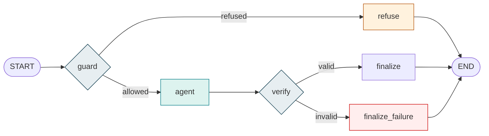

# Arquitectura do agente — LangGraph + Vercel AI SDK

## Porquê LangGraph

O agente precisava de **controlo de fluxo explícito**: validar antes de gastar uma chamada
ao modelo, verificar o resultado antes de o entregar, e ter estados nomeados para,
mais tarde, suspender uma execução à espera de aprovação humana e retomá-la.

Isso é orquestração — decidir *o que acontece a seguir* — e é o que o `StateGraph` resolve
com nós, arestas condicionais e estado tipado. Escrever o mesmo em `if`/`try` cresce mal e
não deixa onde encaixar checkpoints nem human-in-the-loop.

## Porquê manter o Vercel AI SDK

O AI SDK já resolvia bem outra coisa: **falar com o modelo**. Adaptadores para quatro
provedores, streaming token a token, tool calling tipado com Zod e execução das ferramentas.
Substituí-lo por adaptadores da LangChain seria trocar código que funciona por código
equivalente, com risco e sem ganho.

**As duas bibliotecas são complementares, não alternativas:**

| Camada | Responsabilidade |
|---|---|
| **LangGraph** | Estados, nós, arestas, decisões, transições, futura retomada e HITL |
| **Vercel AI SDK** | Chamada ao provedor, streaming, execução de tools, ciclo multi-passo |
| **Express** | HTTP, SSE, rate limit, CORS, validação de entrada |
| **Angular** | Interface do chat |
| **PostgreSQL** | Dados HSE. Checkpoints e memória — fases posteriores |

Só o nó `agent` fala com o modelo. Os outros quatro são lógica pura e testam-se sem rede.

## O grafo



### Nós

| Nó | Faz | Chama o modelo? |
|---|---|---|
| `guard` | Valida a última mensagem: vazia, longa demais, tentativa de injecção | **Não** — uma recusa custa zero |
| `agent` | `streamText` com as tools e `stopWhen: stepCountIs(5)`; emite deltas por SSE | Sim |
| `verify` | Verifica texto não vazio, limite de passos, falha de tool ou provedor | **Não** nesta fase |
| `finalize` | Sela o estado como `COMPLETED` | Não |
| `finalize_failure` | Emite erro controlado com código estável | Não |
| `refuse` | Devolve recusa segura, sem revelar a regra accionada | Não |

### Arestas

- `START → guard`
- `guard → refuse` (refused) · `guard → agent` (allowed)
- `agent → verify`
- `verify → finalize` (valid) · `verify → finalize_failure` (invalid)
- `refuse | finalize | finalize_failure → END`

### Estados

`RECEIVED` · `AUTHORIZED` · `PROCESSING` · `TOOL_EXECUTED` · `VERIFIED` · `COMPLETED` ·
`REFUSED` · `FAILED`

Estado tipado com Zod em `hseAgent.state.ts`, com `runId` (UUID), `conversationId`,
`messages`, `status`, `stepCount`, `toolNames`, `finalText`, `refusalReason` e `errorCode`.

**O estado é serializável de propósito.** Nunca contém o handle do modelo, o pool do
Postgres, callbacks, chaves de API nem o prompt de sistema — esses vivem em `AgentRuntime`
e passam por `config.configurable`. É o que permitirá gravá-lo mais tarde sem revisitar o
desenho. `toolNames` guarda só nomes, nunca argumentos nem resultados, que carregam dados HSE.

## O bug que isto corrigiu

`streamText` era invocado **sem `stopWhen`**. O padrão do SDK é `stepCountIs(1)`: a
ferramenta executava, o resultado nunca voltava ao modelo e o utilizador não recebia texto.

Comprovado com modelo simulado, antes e depois:

```
sem stopWhen          chamadas_ao_modelo=1  tool_executada=1  texto=""
stopWhen(5)           chamadas_ao_modelo=2  tool_executada=1  texto="TRIR e 51,95."
```

O teste 3 fixa este comportamento: falha se `stopWhen` for removido.

## Feature flag

`AI_ORCHESTRATOR=langgraph` (omissão) ou `legacy`. Valor desconhecido → erro de configuração
no arranque, não na primeira chamada.

O caminho `legacy` **também** leva as correcções P0, para que qualquer diferença entre os dois
venha da orquestração e não de bugs antigos. O teste 12 compara ambos e exige texto, tools e
**sequência de eventos SSE idênticos**.

## Contrato com o frontend

Inalterado. O widget Angular continua a ler `{type:'text'|'tool_use'|'error'}` por SSE, com
streaming token a token nos dois caminhos. O evento `done` ganhou campos **opcionais** —
`runId`, `conversationId`, `status`, `toolsUsed`, `stepCount`, `orchestrator` — que o cliente
actual ignora.

## Limitações desta fase

- **`MemorySaver` é volátil.** Existe para desenvolvimento e testes, vive na heap do processo,
  não sobrevive a um restart e não é partilhado entre instâncias. **Não é memória persistente
  e não permite retomada.** O checkpointer Postgres é fase posterior. Por omissão o runner
  corre **sem** checkpointer.
- **RAG não implementado.** Ver `docs/turing-sprint3-rag-audit/`.
- **Human-in-the-loop não implementado.** Os estados e o desenho preparam-no; o mecanismo
  de interrupção e aprovação ainda não existe.
- **Autenticação não implementada.** Sem utilizadores, papéis ou isolamento por tenant.
  `runId` e `conversationId` existem, mas `user_id` e `tenant_id` não.
- **`verify` é estrutural, não semântico.** Verifica que há resposta, não que está correcta
  ou fundamentada. Groundedness pertence à fase de RAG.
- **Sem persistência de traces.** Passos e tools ficam no resultado do run, não numa tabela.
