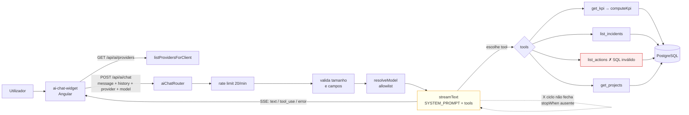
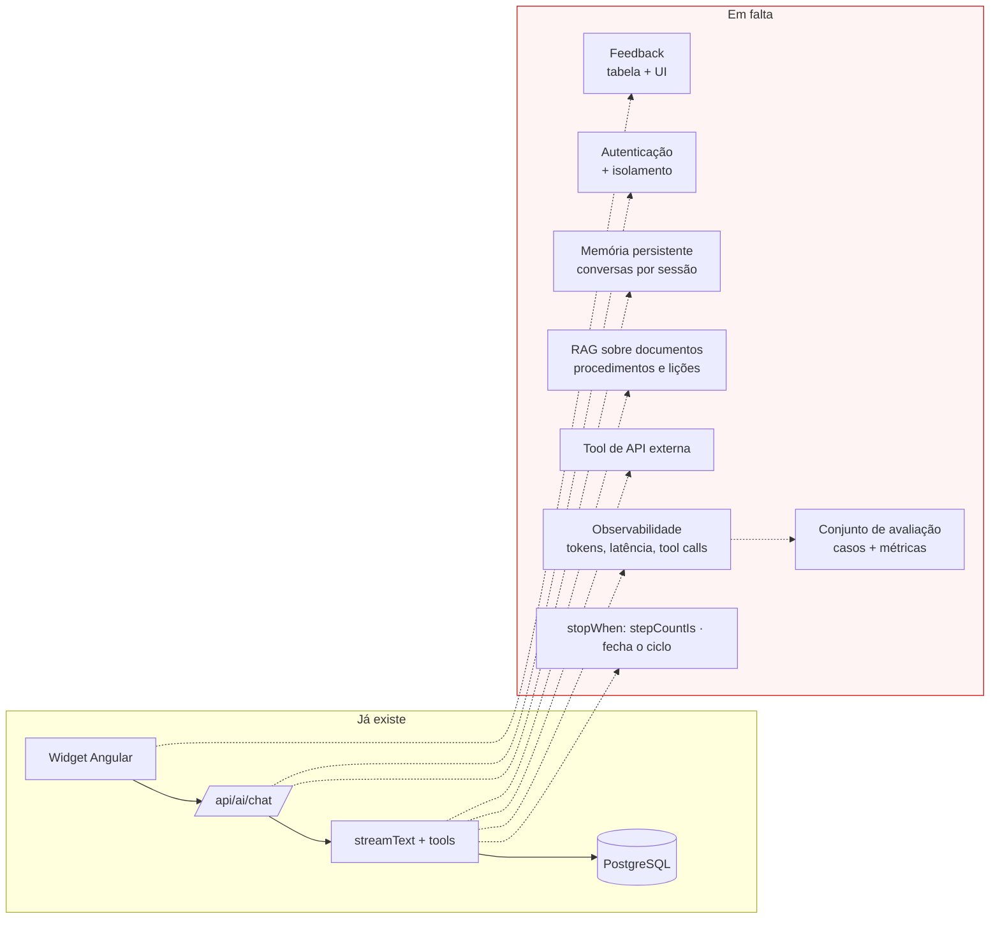

# 04 — Auditoria técnica do agente de IA

## Existe um agente real?

**Sim, o código é um agente genuíno — mas não fecha o ciclo.**

| Pergunta | Resposta | Evidência |
|---|---|---|
| Onde está o backend do agente | `backend/src/routes/aiChat.ts` (196 linhas) | ficheiro único |
| Endpoint que aciona o agente | `POST /api/ai/chat` | `aiChat.ts:129` |
| Endpoint auxiliar | `GET /api/ai/providers` | `aiChat.ts:125` |
| Modelo/provedor | 4 provedores, 11 modelos fixos + custom no Ollama | `providers.ts:27-72` |
| System prompt | constante `SYSTEM_PROMPT`, passada em `system:` | `aiChat.ts:11-19,174` |
| Processamento da mensagem | validação de tipo e tamanho, depois anexada ao histórico | `aiChat.ts:137-144,166-170` |
| Montagem do contexto | `history` (do cliente) cortado a 30 turnos + mensagem actual | `aiChat.ts:112,166` |
| Como decide acções | o modelo escolhe a tool; não há router nem planeador no código | `aiChat.ts:175` |
| Registo de ferramentas | objecto literal `tools`, estático | `aiChat.ts:21-104` |
| Function calling | `tool()` do AI SDK com `inputSchema` Zod e `execute` | `aiChat.ts:22-33` |
| **Resultados voltam ao modelo?** | **NÃO** — `stopWhen` ausente, padrão = 1 passo | `aiChat.ts:172`; `ai/dist/index.js:8412` |
| Loop agentic | **NÃO** (mesma causa) | prova empírica em 09 |
| Planeamento | NÃO | — |
| Roteamento | NÃO | — |
| Estado persistente | NÃO | sem tabelas de IA |
| Memória curta | PARCIAL — no cliente | `ai-chat-widget.component.ts:120` |
| Memória longa | NÃO | 0 tabelas, sem `pgvector` |
| Human-in-the-loop | PARCIAL — por design, não por mecanismo | `aiChat.ts:13` |
| RAG | NÃO | — |
| Guardrails | SIM — 5 | ver secção própria |
| Tratamento de erros | PARCIAL | `aiChat.ts:151-156,185-195` |
| Timeout | NÃO definido | sem `timeout:` no `streamText` |
| Retry | herdado do SDK (`maxRetries = 2`) | `ai/dist/index.js:2675` |
| Fallback entre modelos | NÃO | — |
| Streaming | SIM — SSE | `aiChat.ts:158-163,180-188` |
| Autenticação | NÃO | 0 `canActivate`, sem middleware |
| Isolamento por utilizador | NÃO | não existe conceito de utilizador |
| Auditoria de uso | NÃO | sem logs persistidos |
| Avaliação | NÃO | — |
| Observabilidade | NÃO | — |
| Controlo de custos | PARCIAL — rate limit protege a factura, mas não há medição | `aiChat.ts:117` |
| Feedback do utilizador | NÃO | sem UI e sem persistência |

---

## Defeito 1 — O ciclo agentic não fecha (severidade alta)

```text
Evidência:
- Ficheiro: backend/src/routes/aiChat.ts
- Linhas: 172-178
- Símbolo: streamText({ model, system, tools, messages, maxOutputTokens })
- O que comprova: `stopWhen` não é passado.
```

```text
Evidência:
- Ficheiro: backend/node_modules/ai/dist/index.js
- Linha: 8412
- Símbolo: function streamText({ ... stopWhen = isStepCount(1) ... })
- O que comprova: o padrão do SDK encerra a execução após um passo.
```

Consequência: quando o modelo decide chamar uma ferramenta, a ferramenta **executa**, mas o
resultado não regressa ao modelo e nenhum texto é gerado. O utilizador vê o indicador
"Consultando os dados do sistema…" e depois nada.

Reproduzido com modelo simulado, sem tocar na aplicação:

```
COMO ESTA HOJE (sem stopWhen)     chamadas_ao_modelo=1  tool_executada=1  texto=""
COM stopWhen: stepCountIs(5)      chamadas_ao_modelo=2  tool_executada=1  texto="TRIR e 51,95."
```

Correcção: uma linha — `stopWhen: stepCountIs(5)`.

---

## Defeito 2 — Tool `list_actions` partida (severidade alta)

```text
Evidência:
- Ficheiro: backend/src/routes/aiChat.ts
- Linhas: 84-86
- Símbolo: tools.list_actions.execute()
- O que comprova: SELECT usa `description` e `responsible`.
```

Colunas reais de `action_tracker_capa`: `action_id, source_module, source_reference, project,
action_description, responsible_person, priority, target_date, status, computed_status,
days_remainingoverdue, closure_date, verified_by, evidence_of_closure, comments`.

Verificação directa contra a base:

```
ERROR:  column "description" does not exist
```

As outras três tools foram verificadas contra a base e as suas consultas são válidas.

---

## Ferramentas do agente

| Nome | Finalidade | Entrada | Saída | Efeito colateral | Permissão | HITL | Implementação | Testes | Risco |
|---|---|---|---|---|---|---|---|---|---|
| `get_kpi` | KPIs calculados | `project: string`, `month: 0-11 \| '*'` | objecto de KPI | nenhum (só leitura) | nenhuma | não | **funcional** — reusa `computeKpi()` | nenhum | baixo |
| `list_incidents` | incidentes individuais | `project?`, `limit 1-50 (def. 20)` | linhas | nenhum | nenhuma | não | **funcional** | nenhum | baixo |
| `list_actions` | acções CAPA | `project?`, `status?`, `limit` | linhas | nenhum | nenhuma | não | **PARTIDA** — erro SQL | nenhum | alto |
| `get_projects` | portfólio | `{}` | linhas | nenhum | nenhuma | não | **funcional** | nenhum | baixo |

**Total: 4 declaradas, 3 funcionais.** Nenhuma escreve na base — todas são `SELECT`.

Comparação com a tarefa opcional da Turing:

| Alvo | Estado |
|---|---|
| Uma ferramenta externa (API de terceiros) | **NÃO CUMPRE** — as 4 leem Postgres local |
| Duas ferramentas extra | CUMPRE PARCIALMENTE — há 4, mas nenhuma é externa |
| Cinco ferramentas no total | **NÃO CUMPRE** — 4 declaradas, 3 a funcionar |
| Interface para activar/desactivar tools | **NÃO CUMPRE** |
| Plugin system | **NÃO CUMPRE** — objecto literal estático |

Qualidades reais: `description` escrita para o modelo escolher bem; `inputSchema` com
`min`/`max`/`default`; validação de argumentos delegada ao Zod pelo SDK; SQL sempre
parametrizado (`$1`, `$2`), logo sem injecção.

Ausências: sem `try/catch` dentro de nenhum `execute` — uma falha de BD propaga para o stream
como evento `error` genérico; sem idempotência declarada (irrelevante, são leituras); sem
timeout por ferramenta; sem autorização (não há utilizadores).

---

## Prompt engineering

```text
Evidência:
- Ficheiro: backend/src/routes/aiChat.ts
- Linhas: 11-19
- Símbolo: SYSTEM_PROMPT
```

Conteúdo real: define papel (assistente de dados HSE), **restringe a consultivo**, proíbe
inventar números, exige citar valores exactos das tools, define o comportamento por omissão
(`project="*"`, `month="*"`) e fixa o idioma em português.

| Aspecto | Estado |
|---|---|
| Separação system/user | CUMPRE — `system:` distinto de `messages` |
| Instruções de domínio | CUMPRE |
| Formato de saída | CUMPRE PARCIALMENTE — pede valores exactos, não define estrutura |
| Segurança / anti-injecção | **NÃO CUMPRE** — nada instrui o modelo a ignorar instruções vindas dos dados |
| Limites explícitos | CUMPRE — "nunca invente", "só consultivo" |
| Tom / personalidade | CUMPRE PARCIALMENTE — "direta e objetiva", sem persona |
| Idioma | CUMPRE — fixa português |
| Versionamento | NÃO CUMPRE — constante embutida |
| Testes | NÃO CUMPRE |
| Configuração por ambiente | NÃO CUMPRE |

Risco relevante: os dados HSE são editáveis pelos utilizadores através do CRUD genérico. Um
campo de texto (por exemplo a descrição de um incidente) pode conter instruções e será
devolvido ao modelo por uma tool. Não há defesa contra **prompt injection indirecta**.

---

## Memória e estado

**Curta:** existe na prática. O cliente mantém `messages` num signal e envia o histórico
completo a cada pedido ([`ai-chat-widget.component.ts:120`](../../frontend/src/app/shared/ai-chat-widget/ai-chat-widget.component.ts));
o servidor corta aos últimos 30 turnos (`aiChat.ts:112,166`). Não há resumo, não há expiração
explícita e **perde-se ao recarregar a página** — o `localStorage` só guarda a escolha de
provedor/modelo, não a conversa.

**Longa:** ausente. Sem preferências, factos do utilizador, embeddings, recuperação, edição,
exclusão, consentimento ou retenção.

**Estado do agente:** ausente no servidor. Sem checkpoints, sem retomada, sem workflows.

**Human-in-the-loop:** o sistema é seguro **por construção** — o prompt declara o agente
consultivo e nenhuma ferramenta escreve. Mas não existe mecanismo de confirmação, aprovação,
rejeição ou escalonamento. Se amanhã se acrescentar uma tool de escrita, não há nada a travá-la.

---

## Segurança

Guards **reais e verificáveis**:

1. **Rate limit** — 20 pedidos/minuto (`aiChat.ts:117-122`).
2. **Limite de tamanho** — 4000 caracteres (`aiChat.ts:111,141`).
3. **Allowlist de modelo no servidor** — o cliente não pode pedir um modelo arbitrário em
   provedores cloud (`providers.ts:106-110`); no Ollama, valida por regex.
4. **Segredos nunca expostos** — `listProvidersForClient()` devolve apenas `available`
   (`providers.ts:113-122`).
5. **SQL parametrizado** em todas as tools e rotas.

Ausências: autenticação, autorização, RBAC, sessões, isolamento por tenant, CORS restrito
(`app.use(cors())` aceita qualquer origem), validação de output do modelo, defesa contra
prompt injection, auditoria, logging.

**Resposta ao optional medium "add at least one security guard": CUMPRE.** Há cinco guards
funcionais. Nenhum tem teste automatizado.

---

## Arquitectura real



Legenda: a seta tracejada é o passo **em falta**. Sem ele o fluxo termina no primeiro
`tool-call` e o utilizador não recebe texto.

## Arquitectura recomendada para cumprir a Sprint 3

Apenas os componentes em falta:



---

## Classificação final

**B — Agente funcional básico, não operacional.**

Justificação: o código implementa function calling verdadeiro com schemas, multi-provedor e
streaming, o que ultrapassa claramente as categorias C (chatbot sem comportamento agentic),
D (interface sem backend) e E (mock). Não atinge A porque o ciclo de múltiplos passos —
característica que define um agente — está desactivado por omissão, uma das ferramentas falha
em execução e não há provedor configurado para o executar.

O comportamento fim-a-fim com um LLM real está marcado **NÃO VERIFICADO**: nenhuma chave está
preenchida e o Ollama local não responde. O defeito do ciclo, no entanto, está provado por
leitura do SDK **e** por execução com modelo simulado.
